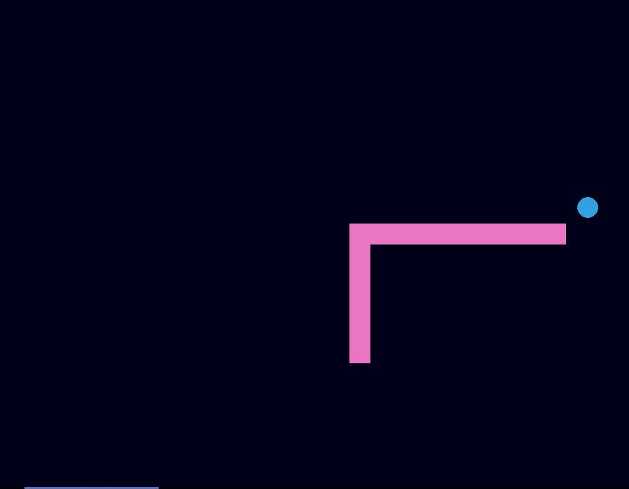

# Curso Pygame

Projetos desenvolvidos durante meu curso de extensão de python + pygame no CEFET-MG (Atual UFCI-MG). 
Durante o curso tive a oportunidade 
O curso foi realizado de Maio à Julho de 2025, e aqui neste repositório trago os projetos que mais me agradaram do mesmo.

## Projeto 1 - Jogo da Cobrinha 🐍

O primeiro projeto usando a biblioteca `pygame` realizado foi a recriação do clássico <b>Snake Game</b>, popularizado em 1997. 
Nele você controla uma cobrinha que se move continuamente pela tela, comendo maçãs ou itens para crescer. Nesse projeto aprendi
as principais funcionalidades da biblioteca, e explorei alguns recursos diversos.

## Projeto 2 - Brick Breaker 🧱

O segundo projeto foi a recriação do clássico jogo <b>Brick Braeker</b>, o qual o jogador deve destruir uma parede de tijolos rebatendo 
uma bola quicando com uma raquete. Nesse projeto, os conceitos de programação orientada à objetos (POO), e a estruturação de projeto
separado em arquivos complementaram na criação de um projeto mais robusto usando o `pygame.`
<i>
  Não consegui restaurar o arquivo 'smw_coin.wav' o que pode gerar erro na execução do projeto breaker, fique a vontade para    testar com algum outro arquivo de áudio qualquer
</i>

*Código restaurado de 2025.*
